<a href="https://neobmo.github.io">
  <picture>
    <source media="(max-width: 600px), (min-width: 768px) and (max-width: 1011px)" srcset="assets/profile-narrow.svg" />
    
  </picture>
</a>

[portafolio](https://neobmo.github.io) · [blog](https://github.com/NeoBmo/blogrdeveloper) · [lobos negros](https://github.com/NeoBmo/LobosNegros) · [linkedin](https://www.linkedin.com/in/luis-rodriguez-reales/)

<code>&gt; cat sobre-mi.md</code>

 

Soy un desarrollador frontend autodidacta de **Barranquilla, Colombia**. En casi 5 años he trabajado en distintos frentes: dando forma a interfaces, dando sentido a datos, y ayudando a negocios a llevar ideas a producción. Ahora canalizo esa experiencia en crecer y construir algo mío

No vengo de una carrera tradicional en sistemas — vengo de aprender resolviendo problemas reales, uno a la vez. Eso me dio algo que valoro mucho: **entender el negocio detrás del código**, no solo escribir componentes bonitos.

Prefiero ser honesto sobre en qué estoy creciendo a aparentar una experiencia que no tengo. Este perfil es justamente eso: un reflejo real de mi camino, no una vitrina.

- **Frontend real:** React, TypeScript, Next.js, TailwindCSS — mi base más sólida.
- **De Figma a producción:** traducir diseños a interfaces funcionales y mantenibles.
- **E-commerce:** Shopify, personalización de tiendas, integraciones.
- **IA aplicada:** uso IA como herramienta de investigación, validación y debugging en mi flujo de trabajo diario.
- **Conectando piezas:** APIs, CRMs, Meta/WhatsApp, automatizaciones de negocio.
- **Full-stack funcional:** entiendo APIs, bases de datos y arquitectura lo suficiente para no perderme en una conversación técnica completa.

