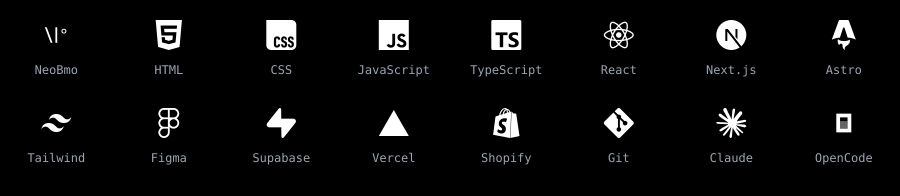
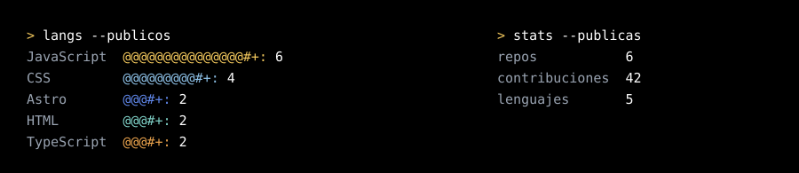

<a href="https://neobmo.github.io">
  <picture>
    <source media="(max-width: 600px), (min-width: 768px) and (max-width: 1011px)" srcset="assets/profile-narrow.svg" />
    
  </picture>
</a>

Frontend developer autodidacta. Me fascina el diseño UX/UI y llevarlo a código.

**[neobmo.github.io](https://neobmo.github.io)**

  <picture>
    <source media="(max-width: 600px), (min-width: 768px) and (max-width: 1011px)" srcset="assets/stack-narrow.svg" />
    
  </picture>

  <picture>
    <source media="(max-width: 600px), (min-width: 768px) and (max-width: 1011px)" srcset="assets/stats-narrow.svg" />
    
  </picture>

